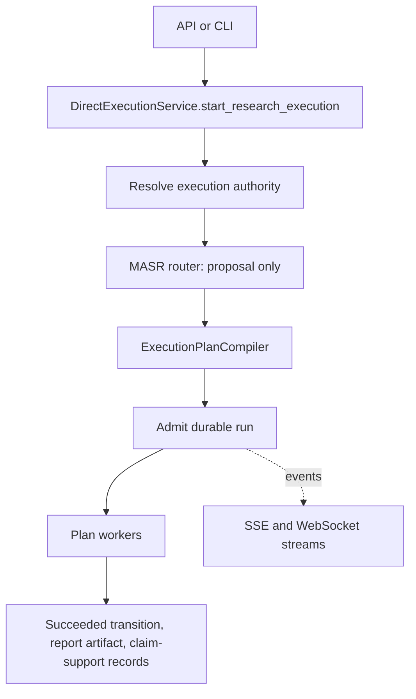

# Cerebro

> An open-source workbench for building, running and evaluating
> source-grounded AI research workflows.

Cerebro turns a research objective into an explicit execution run, routes the
work to specialized agents, checks the result and records the operational
signals that show how the workflow behaved. The aim is a multi-agent research
system you can inspect and test.

Finance, academic research, analytics and content are implemented as agent
domains. Finance is a bundled example of domain specialization; see
[Scope](#scope) for what Cerebro is not.

## Project Status

Each reference page marks features as Active, Off by default or Not wired; the
[documentation index](docs/README.md) is the entry point.

| Area | Current state |
| --- | --- |
| Multi-agent execution | Plan-based. MASR (the Multi-Agent System Router) proposes a routing, a stored execution authority binds it and workers run per the compiled plan ([research execution](docs/reference/05-research-execution.md)) |
| Verification | The verification gate runs in supervisor execution (the supervisor API and the TalkHier and coordination services; TalkHier is the structured, multi-round message protocol supervisors use to talk to their workers), not on the query path ([agents and supervisors](docs/reference/07-agents-and-supervisors.md)) |
| Multi-domain queries | Execution accepts single-domain plans only; a multi-domain query is rejected before any work starts |
| Provider routing | `GeminiService` is the default client for calls outside a compiled plan. A plan-backed route must name the `deepseek`, `llama` or `openrouter` provider, because the `gemini` provider rejects every request. The multi-provider OpenRouter route is off by default ([LLM providers](docs/reference/10-llm-providers.md)) |
| API and CLI | Mounted under `/api/v1`; every route except an explicit public allowlist requires a bearer token ([HTTP API](docs/reference/03-http-api.md)) |
| Evidence model | Claim-support records are written for each final report, each recorded as unsupported with reason `not_attempted`; search evidence and source snapshots are off by default ([tool boundary and evidence](docs/reference/09-tool-boundary-and-evidence.md)) |
| Durable runs | Each execution is a database run with an append-only event log, replayable over SSE and WebSocket ([durable runs and events](docs/reference/08-durable-runs-and-events.md)) |
| Fixture-backed execution | `DirectExecutionService.start_research_execution` accepts a fixture mode, but no route or client passes it |
| Visual workbench | The research projects page calls mounted routes. The agents page lists agents from a mounted route, but its logs route is not mounted. The workflow, run and memory pages call routes the API does not mount. The dashboard, QA, cost and benchmark pages show fixed values and the settings page has no handlers; none of them calls the API ([CLI and web clients](docs/reference/13-cli-and-web-clients.md)) |

## Why Cerebro

Cerebro is built around making the research process inspectable. A query
becomes an explicit workflow plan, not an opaque chat response. Task delegation,
status, latency and cost are visible. Evidence and provenance attach to claims
and artifacts, verification is bounded and its outcomes can be inspected, and
evaluation cases make changes in quality measurable.

## Current Capabilities

### Runtime

- MASR routing analyzes a query and selects a domain, collaboration mode,
  routing strategy and execution path.
- Domain supervisors for Research, Content, Analytics and Finance coordinate
  workers. The supervisor API serves Research, Content, Analytics, Service and
  General, not Finance.
- Verification applies a PASS/REVISE quality gate to supervisor results.
- Plan execution keeps the primary path in process:
  `API -> DirectExecutionService -> MASR proposal -> ExecutionPlan -> workers`.

### Engineering Surface

- FastAPI endpoints for routed queries, direct agent execution, routing
  inspection, research projects, reports and WebSocket updates.
- A Click/Rich CLI for health checks, routed queries, routing estimates, direct
  agent calls, chains and research-project operations.
- Optional Langfuse tracing, Prometheus metrics, structured logging, PostgreSQL,
  and Redis integration.
- Docker Compose and Kubernetes assets for local and deployed environments.

### Included Domains

| Domain | Workers | Intended role |
| --- | --- | --- |
| Research | literature review, comparative analysis, methodology, synthesis, citation | General research decomposition and synthesis |
| Analytics | data analysis, statistical modeling, insight synthesis | Analysis of user-provided data and context |
| Content | planning, drafting, editing, optimization | Structured content production |
| Finance | financial analysis, valuation, risk assessment | Example specialization over user-provided figures and assumptions |

The Finance domain does not retrieve live market data, filings, news or
transcripts. Its deterministic calculator handles a small set of financial
math operations; LLM workers provide narrative analysis.

## Quick Start

### Prerequisites

- Python 3.11+
- Docker and Docker Compose
- `uv`, or a standard Python virtual environment

### Install

```bash
git clone https://github.com/jsogarro/cerebro.git
cd cerebro
uv venv && . .venv/bin/activate
uv pip install -e ".[dev]"
```

If `uv` is unavailable:

```bash
./scripts/setup-python-env.sh
. .venv/bin/activate
```

Create local configuration:

```bash
cp .env.example .env
cp .env.cli.example .env.cli
```

Python processes load optional dotenv values with this precedence:
an already-exported process variable, then `~/.env`, then the repository
`.env`, then the application default. Exported empty values are preserved.
Dotenv files are parsed as data and are not shell-sourced. Keep them
uncommitted and restrict secret-bearing files (for example, `chmod 600 ~/.env`).

`GEMINI_API_KEY` enables live calls through the default `GeminiService` client
and can be exported, stored in `~/.env` or stored in the project `.env`. A
plan-backed route needs the key of the provider it names. Provider keys are
optional for API startup; calls that need an unavailable provider use the
documented fallback behavior.

### Run

Start the supporting services:

```bash
./scripts/compose.sh up -d
```

The wrapper passes the project `.env` and then `~/.env` to Docker Compose with
absolute paths; exported shell variables remain highest priority. Plain
`docker compose` remains supported, but it does not load `~/.env` automatically.
The default stack uses the FastAPI-owned in-process MASR runtime. The standalone
port-9100 diagnostics service is legacy-only:

```bash
./scripts/compose.sh --profile legacy-masr-service up -d masr-router
```

Adaptive Thompson routing is off by default. The scripts that evaluate it and
produce a promotion report are described in the
[testing guide](docs/testing-guide.md#adaptive-routing-evaluation).

Or run the API directly:

```bash
uvicorn src.api.main:app --host 0.0.0.0 --port 8000
```

Check health:

```bash
research-cli health
```

Run the repository smoke test:

```bash
./scripts/smoke_test.sh
```

The script currently fails its last check. It sends `POST /api/v1/query/research`
without a token and expects 200, but the route requires a bearer token and
answers 401, so the script reports `FAIL` and exits 1 even when every earlier
check passes ([development setup](docs/development-setup-guide.md#smoke-tests)).

### Submit a Routed Query

```bash
export RESEARCH_AUTH_TOKEN="$TOKEN"
research-cli agents query \
  "Compare the strongest arguments for and against retrieval-augmented generation" \
  --authority-id "<authority-id>" --authority-version "<authority-version>"
```

The same request with `curl` (the CLI sends `domains` only when `-d` is passed):

```bash
curl -X POST "http://localhost:8000/api/v1/query/research" \
  -H "Authorization: Bearer $TOKEN" \
  -H "Content-Type: application/json" \
  -d '{
    "query": "Compare the strongest arguments for and against retrieval-augmented generation",
    "domains": ["research"],
    "authority_reference": {"authority_id": "<authority-id>", "authority_version": "<authority-version>"}
  }'
```

The token needs an organization claim, and `authority_reference` must name an
execution authority stored for that organization. A fresh install has no route,
CLI command or script that creates an execution authority, so until a
deployment supplies one this request returns `EXECUTION_AUTHORITY_REQUIRED` or
`EXECUTION_AUTHORITY_UNAVAILABLE` ([research
execution](docs/reference/05-research-execution.md#execution-authority)). The
[development setup guide](docs/development-setup-guide.md#get-an-access-token)
covers obtaining a token. With an authority in place, the endpoint starts
execution asynchronously and returns execution metadata; several response
fields are fixed or `null` on this path and are listed in the same page.

## Architecture

### Current Runtime



### Core concepts

- **Run, task and attempt**: the durable records of one execution; see
  [durable runs and events](docs/reference/08-durable-runs-and-events.md).
- **Execution plan**: the immutable plan compiled from a routing proposal and a
  stored authority; see [research execution](docs/reference/05-research-execution.md).
- **Evidence and artifact**: source snapshots, cited spans and the final report
  artifact; see [tool boundary and evidence](docs/reference/09-tool-boundary-and-evidence.md).
- **Claim support**: one record per material claim of a report; see the same page.

Related pages:

- [Documentation index](docs/README.md), which links all fifteen reference pages
- [Troubleshooting](docs/troubleshooting.md)
- [Architecture overview](docs/reference/01-architecture-overview.md)
- [Configuration](docs/reference/02-configuration.md)
- [HTTP API](docs/reference/03-http-api.md)
- [Agents and supervisors](docs/reference/07-agents-and-supervisors.md)
- [CLI and web clients](docs/reference/13-cli-and-web-clients.md)

## Repository Layout

```text
cerebro/
├── src/
│   ├── agents/            # Workers, supervisors, verification
│   ├── ai_brain/          # MASR, query analysis, provider routing
│   ├── api/               # FastAPI routes and execution services
│   ├── cli/               # Click/Rich command-line client
│   ├── core/              # Configuration and shared runtime services
│   ├── mcp/               # MCP servers and tool definitions
│   ├── models/            # API, domain, and persistence models
│   ├── repositories/      # Data access
│   └── services/          # Model, report, and supporting services
├── cerebro/web/           # React workbench scaffold
├── tests/                 # Unit, integration, E2E, and evaluation tests
├── docs/                  # Public technical documentation
├── docker/                # Container configuration
└── k8s/                   # Kubernetes manifests
```

## Development

Run targeted tests while iterating:

```bash
pytest tests/test_query_analyzer_decomposition.py -q
pytest tests/test_query_decomposer.py -q
pytest tests/test_direct_execution_service.py -q
```

Run the standard checks:

```bash
pytest
ruff format --check src tests
ruff check src tests
mypy src
```

Before opening a pull request, check each documentation claim you changed
against the code it describes.

## Scope

Cerebro is a developer-focused open-source project. It is not:

- an investment-advice or trading system;
- an institutional financial-data product;
- a general autonomous-agent framework for arbitrary computer use;
- a production SaaS with billing and enterprise administration;
- evidence that additional agents automatically improve answer quality.

## Legacy Names

Several concrete identifiers still use the original `research-platform` naming,
including package metadata, database and deployment resources, the
`research-cli` executable, and portions of the API.

## Support

Use [GitHub Issues](https://github.com/jsogarro/cerebro/issues) for bugs and
feature proposals. Include the workflow, provider configuration, execution ID,
and relevant trace details when reporting runtime failures.
