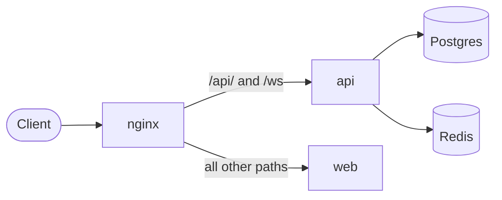
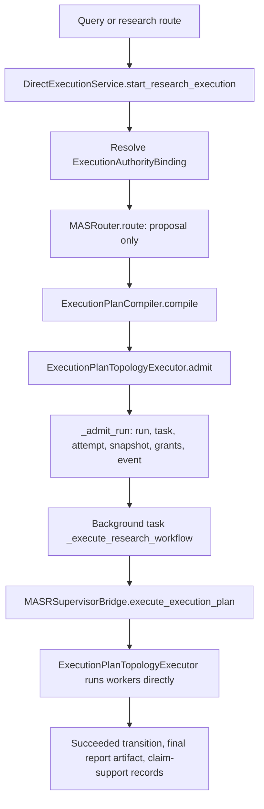

# Architecture overview

Cerebro is a FastAPI application that accepts research queries, routes each one through MASR, the Multi-Agent System Router ([MASR routing](06-masr-routing.md)), runs the routed work through in-process workers and records each run in Postgres. This page describes the processes, the application assembly, the request path, the execution paths and the shared registry and contracts that the other reference pages build on.

## Summary

| Feature | Status | Entry point | Source |
|---|---|---|---|
| HTTP application and middleware | Active | `uvicorn src.api.main:app` | `src/api/main.py` (`app`, `lifespan`) |
| Authentication and tenancy | Active | `AuthMiddleware`, `get_tenant_context` | `src/middleware/auth_middleware.py` (`AuthMiddleware`), `src/middleware/tenant_context.py` (`get_tenant_context`) |
| Research execution | Active | `POST /api/v1/query/research` | `src/api/services/direct_execution_service.py` (`DirectExecutionService.start_research_execution`) |
| MASR routing | Active | `MASRouter.route`, called by `DirectExecutionService._propose_routing` | `src/ai_brain/router/masr.py` (`MASRouter`) |
| Agents and supervisors | Active | `/api/v1/agents`, `/api/v1/supervisors` | `src/api/routes/agent_api.py`, `src/api/routes/supervisor_api.py` |
| TalkHier (multi-round supervisor messaging) and supervisor coordination | Active | `/api/v1/talkhier`, `/api/v1/supervisors` | `src/api/services/talkhier_session_service.py` (`TalkHierSessionService`), `src/api/services/supervisor_coordination_service.py` (`SupervisorCoordinationService`) |
| Durable runs and events | Active | run admission in `DirectExecutionService._admit_run` | `src/models/db/run_lifecycle.py`, `src/models/db/run_event.py`, `src/api/services/outbox_relay.py` (`OutboxRelay`) |
| Realtime delivery | Active | `/ws`, `/ws/projects/{project_id}`, `/ws/cli/{project_id}`, `/ws/runs/{run_id}`, `GET /api/v1/runs/{run_id}/events` | `src/api/routes/websocket.py`, `src/api/routes/run_stream.py` |
| Tool boundary: in-process tools | Active | `ToolRegistry` used by `LLMWorkerAgentBase` | `src/agents/tools/registry.py` (`ToolRegistry`), `src/core/tools/boundary.py` (`ToolBoundary`) |
| Tool boundary: MCP tool path | Active | `MCP_TOOL_PATH_ENABLED` (default `true`) | `src/ai_brain/integration/masr_supervisor_bridge.py` (`MASRSupervisorBridge._execute_plan_worker`), `src/core/config.py` (`Settings.MCP_TOOL_PATH_ENABLED`) |
| Claim-support records for final reports | Active | written with the run's succeeded transition | `src/api/services/direct_execution_service.py` (`DirectExecutionService._commit_transition`), `src/core/claims/resolution.py` (`ClaimSupportResolver`) |
| Search evidence recording | Active | `MCP_TOOL_PATH_ENABLED` (default `true`) | `src/ai_brain/integration/masr_supervisor_bridge.py` (`SearchEvidenceRecorder` wiring) |
| LLM provider: Gemini | Active | `GeminiService` when `GEMINI_API_KEY` is set | `src/api/main.py` (`lifespan`), `src/services/gemini_service.py` |
| LLM providers: multi-provider routing | Off by default | `MULTI_PROVIDER_ROUTING_ENABLED=true` with `OPENROUTER_API_KEY` | `src/agents/llm_worker_base.py` (`_generate_with_routing`), `src/core/config.py` (`Settings.MULTI_PROVIDER_ROUTING_ENABLED`) |
| Reports | Active | `/api/v1/reports` | `src/api/routes/reports.py` |
| Audit trail | Active | `AuditTrailMiddleware` | `src/security/audit_middleware.py` (`AuditTrailMiddleware`), `src/security/audit_logger.py` (`AuditLogger`) |
| Prometheus metrics | Active | `/metrics` | `src/api/main.py` (`make_asgi_app`) |
| Langfuse tracing | Off by default | `LANGFUSE_ENABLED=true` | `src/core/config.py` (`Settings.LANGFUSE_ENABLED`), `src/core/tracing.py` |
| CLI | Active | `research-cli` | `src/cli/main.py` (`cli`), `pyproject.toml` (`[project.scripts]`) |
| Web workbench | Active (partly backed; see [CLI and web clients](13-cli-and-web-clients.md)) | `web` compose service | `cerebro/web`, `docker-compose.yml` |
| Persistence | Active | `init_db` during `lifespan` | `src/models/db/session.py` (`init_db`, `get_session_factory`) |
| Code that is not wired | Not wired | none | see [not wired](15-not-wired.md) |

Subsystems are detailed on their own pages ([documentation index](../README.md)). Code with no production caller is listed in [not wired](15-not-wired.md); two instances belong here: the citation contract module (`src/core/contracts/citation.py`) and the execution-policy fixture mode of `DirectExecutionService`; the second is described in [research execution](05-research-execution.md).

## Processes

The `docker-compose.yml` stack runs these services.

| Service | What it runs |
|---|---|
| `api` | The FastAPI application, started with `uvicorn src.api.main:app --host 0.0.0.0 --port 8000`. |
| `postgres` | `postgres:16-alpine`, initialised from `docker/init.sql`. |
| `redis` | `redis:7-alpine` with `--appendonly yes`. The API's idempotency store and rate-limit store connect to it through `REDIS_URL`. |
| `web` | The React workbench built from `cerebro/web`, served by its own nginx on container port 8080. |
| `nginx` | A reverse proxy built from `docker/nginx/nginx.conf`. It answers `/health` itself, proxies `/api/` and `/ws` to the `api` upstream, serves `/docs` from its own static root and proxies every other path to the `web` upstream. |
| `pgadmin`, `redis-commander` | Development tools in the `dev-tools` profile. |

See the [deployment guide](../deployment-monitoring-guide.md) for how the services are started.

## Application assembly

`src/api/main.py` (`lifespan`) assembles the application. `lifespan` runs these steps in order.

1. Registers the JWT service for closing at shutdown (`close_jwt_service`).
2. Builds the MASR runtime with `MASRRuntime.create(settings)` and stores it on `app.state.masr_runtime`.
3. Initialises the shared `event_publisher`. A failure is logged and startup continues.
4. Calls `init_db()`. On success the flag `database_initialized` is true. `init_db` creates the engine and session factory and runs `SELECT 1`; if that probe fails it closes the engine and re-raises, and `lifespan` catches the exception, logs `Database initialization failed` and continues with `database_initialized` false.
5. When `DATABASE_URL` contains `sqlite`, creates these tables with `Base.metadata.create_all`: `research_projects`, `research_results`, `workflow_checkpoints`, `agent_runs`, `agent_run_tasks`, `agent_task_attempts`, `agent_run_config_snapshots`, `agent_run_events` and `agent_run_event_outbox`. On Postgres `lifespan` creates no tables; the schema comes from the migrations in `alembic/versions`.
6. Creates `GeminiService` only when `GEMINI_API_KEY` is set. Otherwise it logs that agents use fallback responses.
7. Builds the component registry with `build_application_component_registry()`.
8. Looks up the session factory with `get_session_factory()` when `database_initialized` is true; a failure leaves `durable_session_factory` as `None`.
9. Calls `configure_direct_execution_service(gemini_service=..., masr_router=masr_runtime.router, component_registry=..., session_factory=durable_session_factory, event_publisher=event_publisher)`.
10. Sets the execution authority resolver on the service: a resolver already present on `app.state.execution_authority_resolver` wins; otherwise, with a session factory, it builds a `PersistedExecutionAuthorityResolver` and warms it with `warm_from_snapshots`; without a session factory the resolver is `None`.
11. With a session factory, calls `restore_active_executions()` and then creates and starts an `OutboxRelay(session_factory=..., event_publisher=...)`. Without a session factory neither runs.
12. Creates and starts `AuditLogger(session_factory=durable_session_factory)` and stores it on `app.state.audit_logger`.
13. Stores the `DirectExecutionService` on `app.state.direct_execution_service`.
14. Calls `configure_agent_execution_service(component_registry=...)` and stores the result on `app.state.agent_execution_service`.
15. Composes the research kernel with `compose_application_research_kernel(direct_execution_service, agent_execution_service)` and stores it on `app.state.research_kernel`.
16. Creates `MASRRoutingService`, `TalkHierSessionService` and `SupervisorCoordinationService` and stores them on `app.state` as `masr_routing_service`, `talkhier_session_service` and `supervisor_coordination_service`.
17. When `LANGFUSE_ENABLED` is true, creates the Langfuse client on a worker thread so the first request does not pay for it.

When the database is unavailable at startup, the service runs with no session factory: runs are held in process memory only, no durable rows or events are written, the outbox relay does not start and `execution_authority_resolver` is `None`, so the API refuses every request that starts a research execution with `EXECUTION_AUTHORITY_UNAVAILABLE` (or `EXECUTION_AUTHORITY_REQUIRED` when it carries no authority reference).

On shutdown, `lifespan` first closes `websocket_manager`, then shuts down Langfuse with a 5 second timeout, then closes the resources registered above in reverse order of registration. A failure while closing one resource is logged and does not stop the others (`_close_lifespan_resource`). The lifespan does not call `close_db`.

## Request path

The table lists the middleware outermost first, which is the order a request meets them. `src/api/main.py` registers them in the reverse order, because Starlette runs the last-registered middleware outermost.

| Position | Middleware | Registered as |
|---|---|---|
| 1 | `CORSMiddleware` | `app.add_middleware`, registered last |
| 2 | `SecurityHeadersMiddleware` | `app.middleware("http")`, with HSTS enabled when `ENVIRONMENT` is not `development` |
| 3 | `log_rejected_requests` | `app.middleware("http")` |
| 4 | `AuthMiddleware` | `app.add_middleware` |
| 5 | `LLMCostDriftMiddleware` | `app.add_middleware` |
| 6 | `RateLimitMiddleware` | `app.add_middleware`, with `ResilientRateLimitStore(RedisRateLimitStore(...))`, `requests_per_minute=settings.MAX_REQUESTS_PER_MINUTE` and `enabled=settings.ENABLE_RATE_LIMITING` |
| 7 | `AuditTrailMiddleware` | `app.middleware("http")` |
| 8 | `IdempotencyMiddleware` | `app.add_middleware`, registered first, with `ResilientIdempotencyStore(RedisIdempotencyStore(...))` |

CORS terminates browser preflight requests before authentication. `AuthMiddleware` validates the JWT for every request except the exact method-and-path pairs in `PUBLIC_ROUTE_ALLOWLIST` (`src/middleware/auth_middleware.py`). Audit sits inside authentication and rate limiting, so a request they reject does not cause a durable audit write.

Three exception handlers return the error envelope from `src/api/middleware/error_envelope.py`: `HTTPException`, `RequestValidationError` and `Exception`.

Routers mounted by `src/api/main.py`:

| Prefix | Module |
|---|---|
| none (`/health`, `/ready`, `/live`) | `src/api/routes/health.py` |
| `/api/v1/auth` | `src/api/auth/auth_router.py` |
| `/api/v1/users` | `src/api/routes/users.py` |
| `/api/v1/research` | `src/api/routes/research.py` |
| `/api/v1/reports` | `src/api/routes/reports.py` |
| `/api/v1/query` | `src/api/routes/query_api.py` |
| `/api/v1/agents` | `src/api/routes/agent_api.py` |
| `/api/v1/masr` | `src/api/routes/masr_api.py` |
| `/api/v1/supervisors` | `src/api/routes/supervisor_api.py` |
| `/api/v1/talkhier` | `src/api/routes/talkhier_api.py` |
| none (`/ws`, `/ws/projects/{project_id}`, `/ws/cli/{project_id}`, `/ws/runs/{run_id}`, `/ws/health`) | `src/api/routes/websocket.py` |
| `/api/v1` (`/runs/{run_id}/events`) | `src/api/routes/run_stream.py` |
| `/metrics` | Prometheus ASGI app from `prometheus_client.make_asgi_app` |

See [HTTP API](03-http-api.md) for the request and response contracts and [authentication and tenancy](04-authentication-and-tenancy.md) for the identity model.

## Execution paths

**(a) The plan path.** `POST /api/v1/query/research` (and its `/analyze` and `/synthesize` wrappers) call `DirectExecutionService.start_research_execution`; the `/literature`, `/methodology` and `/comparison` wrappers build their request without an `authority_reference`, so their start attempt is refused with `EXECUTION_AUTHORITY_REQUIRED` (see [research execution](05-research-execution.md#entry-points)); `POST /api/v1/research/projects` calls it too, without an `organization_id`, so that start attempt is refused (see [research execution](05-research-execution.md#entry-points)). The service resolves an execution authority binding and asks MASR for a routing proposal (`_propose_routing`). It compiles the proposal against the binding with `ExecutionPlanCompiler`, validates the plan with `MASRSupervisorBridge.admit_execution_plan`, admits the run in the database (`_admit_run`) and starts a background task. The task calls `MASRSupervisorBridge.execute_execution_plan`, which delegates to `ExecutionPlanTopologyExecutor`. That executor runs plan-local worker instances directly: it does not consult MASR, supervisors, LangGraph StateGraphs or the verification gate. [Research execution](05-research-execution.md) documents this path step by step.

**(b) The supervisor path.** `POST /api/v1/supervisors/{supervisor_type}/execute`, `POST /api/v1/supervisors/{supervisor_type}/coordinate` and `POST /api/v1/supervisors/multi/orchestrate` reach `SupervisorCoordinationService._execute_with_workers`, which calls `RealSupervisorExecutor.execute_with_workers`. That calls `SupervisorExecutor.execute`, which takes a supervisor from the resource pool and calls `BaseSupervisor.execute`. `BaseSupervisor.execute` runs the supervisor's LangGraph `StateGraph` with `workflow_graph.ainvoke`, and supervisor workflow nodes call the verification gate (`_run_verification`). This path creates no run, task or attempt rows. See [agents and supervisors](07-agents-and-supervisors.md).

**(c) Direct agent calls.** `POST /api/v1/agents/{agent_type}/execute`, `POST /api/v1/agents/chain` and `POST /api/v1/agents/mixture` call `AgentExecutionService`, which runs agent classes from the component registry. The route first checks that `authority_reference` is present and resolves for the caller's organization (`_require_agent_execution_authority`); the service itself uses no authority binding, no session factory and writes no run rows. See [agents and supervisors](07-agents-and-supervisors.md).

## Component registry

`src/core/kernel/registry.py` defines `TypedRegistry`, an immutable collection of `RegistryEntry` values addressed by `RegistryKey`. A key is a `RegistryNamespace` (`agent`, `domain`, `provider`, `supervisor`, `workflow`) plus a lower-case name. `TypedRegistry.resolve` returns the component or raises `UnknownRegistryKeyError`; a duplicate key at construction raises `DuplicateRegistryKeyError`.

`src/core/kernel/component_keys.py` declares the key sets:

| Key set | Contents |
|---|---|
| `AGENT_KEYS` | 17 agent keys, with underscores in names mapped to hyphens (`literature_review`, `comparative_analysis`, `methodology`, `synthesis`, `citation`, `financial_calculator`, `content_planning`, `drafting`, `editing`, `optimization`, `data_analysis`, `statistical_modeling`, `insight_synthesis`, `financial_analysis`, `valuation`, `risk_assessment`, `verification`) |
| `API_AGENT_KEYS` | one key per `AgentType` value, mapped onto `AGENT_KEYS` |
| `SUPERVISOR_KEYS` | `analytics`, `content`, `finance`, `research` |
| `DOMAIN_KEYS` | `analytics`, `content`, `finance`, `general`, `multimodal`, `research`, `service` |
| `PROVIDER_KEYS` | `deepseek`, `gemini`, `llama`, `openrouter` |
| workflow keys | `ROUTED_RESEARCH_WORKFLOW_KEY`, `DIRECT_AGENT_WORKFLOW_KEY`, `AGENT_CHAIN_WORKFLOW_KEY`, `AGENT_MIXTURE_WORKFLOW_KEY`, `COLLABORATION_MODE_WORKFLOW_KEY` |

`build_application_component_registry()` in `src/api/services/component_catalog.py` registers 17 agents, 4 supervisors, 7 domains, 4 providers and 5 workflows, 37 entries in all. Each domain entry maps a domain name to a supervisor name: `finance` and `general` map to `research`, `multimodal` maps to `content` and `service` maps to `service`. `DirectExecutionService` validates that `SUPERVISOR_KEYS["research"]` resolves and that every registered supervisor is a `BaseSupervisor` subclass (`_validate_supervisor_registry`).

`src/api/services/research_kernel.py` wraps the registry in a `ResearchKernel`, whose `execute` delegates to one executor callable. `compose_application_research_kernel` builds the adapter the query and agent routes call; for routed research the adapter resolves `ROUTED_RESEARCH_WORKFLOW_KEY` and calls it, and the registered workflow (`execute_routed_research`) calls `DirectExecutionService.start_research_execution`. The kernel package also holds `BoundedTaskRunner` (`src/core/kernel/bounded_concurrency.py`), used by `BaseSupervisor.execute_workers_parallel` and by the agent mixture path of `AgentExecutionService`.

## Contracts package

`src/core/contracts/` holds the frozen Pydantic records that the runtime, the repositories and the database models share. The runtime imports it: `src/api/services/direct_execution_service.py` imports `Run`, `Task`, `Attempt`, `RunStatus` and the artifact and capability contracts and `src/api/services/outbox_relay.py` imports the event contracts.

| Module | Contents | Detailed on |
|---|---|---|
| `base.py` | `ContractModel` and shared field types | none |
| `definitions.py` | `WorkflowDefinition`, `RoutingPolicy`, `WorkflowControlMode` | [research execution](05-research-execution.md) |
| `execution_plan.py` | `ExecutionPlan`, `RoutingDecision`, `ExecutionBudget`, `ProviderModelPolicy`, `CollaborationMode`, `COLLABORATION_MODE_SUPPORT` | [research execution](05-research-execution.md) |
| `lifecycle.py` | `Run` | [durable runs and events](08-durable-runs-and-events.md) |
| `task_lifecycle.py` | `Task`, `Attempt` | [durable runs and events](08-durable-runs-and-events.md) |
| `states.py` | `RunStatus`, `TaskStatus`, `AttemptStatus`, legal-transition checks | [durable runs and events](08-durable-runs-and-events.md) |
| `outcomes.py` | `RunEvent`, `EvaluationResult` | [durable runs and events](08-durable-runs-and-events.md) |
| `streaming.py` | `RunEventCursor`, `delivery_idempotency_key` | [durable runs and events](08-durable-runs-and-events.md) |
| `pinning.py` | `PinnedVersions`, `PinnedComponentVersion` | [tool boundary and evidence](09-tool-boundary-and-evidence.md) |
| `capabilities.py` | `CapabilityGrant`, `CapabilityRequest`, `CapabilityDecision`, `decide_capability` | [tool boundary and evidence](09-tool-boundary-and-evidence.md) |
| `trust.py` | `TrustClassification`, `propagate_trust` | [tool boundary and evidence](09-tool-boundary-and-evidence.md) |
| `redaction.py` | `SecretRef`, `redact`, `boundary_digest`, `snapshot_digest` | [tool boundary and evidence](09-tool-boundary-and-evidence.md) |
| `provenance.py` | `ToolInvocation`, `Artifact`, `Evidence`, `ClaimSupport`, `PromptBinding` | [tool boundary and evidence](09-tool-boundary-and-evidence.md) |
| `locators.py` | `Locator`, `parse_locator` | [tool boundary and evidence](09-tool-boundary-and-evidence.md) |
| `citation.py` | `CitationMetadata`, `CitationRecord`, `CitationBindingResult` | [not wired](15-not-wired.md) |

## LangGraph usage

`langgraph>=0.2.0` is declared in `pyproject.toml`. Modules under `src/agents/supervisors/` are the only ones in `src` that import it; each concrete supervisor (`ResearchSupervisor`, `ContentSupervisor`, `AnalyticsSupervisor`, `FinanceSupervisor`) builds its own `StateGraph` in `_build_workflow_graph` and `BaseSupervisor.execute` runs it with `ainvoke`. The plan path described above does not use LangGraph.

## Source map

- `src/api/main.py`: application construction, lifespan, middleware order and router mounts
- `src/api/services/direct_execution_service.py`: the plan path (admission, execution, durable transitions, status and cancellation)
- `src/api/services/research_kernel.py`: kernel composition and the adapter the routes call
- `src/api/services/component_catalog.py`: `build_application_component_registry` and the registered workflow callables
- `src/core/kernel/`: `TypedRegistry`, `RegistryKey`, component key sets, `ResearchKernel`, `BoundedTaskRunner`
- `src/core/contracts/`: frozen contract records shared by the runtime and the database layer
- `src/ai_brain/router/execution_plan_compiler.py`: `ExecutionPlanCompiler`
- `src/ai_brain/integration/masr_supervisor_bridge.py`: `MASRSupervisorBridge`, `SupervisorExecutor`, `ResourcePool`
- `src/ai_brain/integration/execution_plan_topology.py`: `ExecutionPlanTopologyExecutor`
- `src/api/services/supervisor_coordination_service.py` and `src/api/services/real_supervisor_executor.py`: the supervisor path
- `src/api/services/agent_execution_service.py`: direct agent calls
- `docker-compose.yml` and `docker/nginx/nginx.conf`: the process topology
